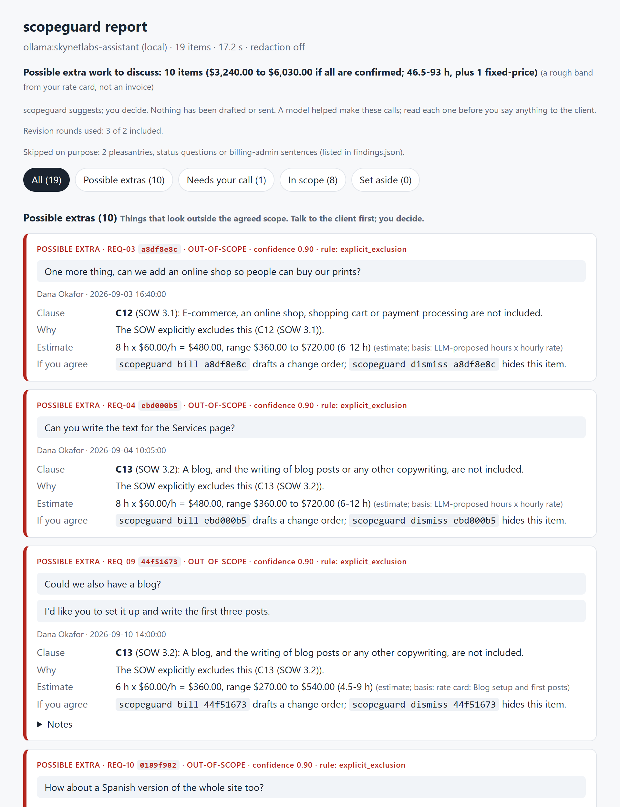

# scopeguard: scope-creep detector for freelancers and small agencies




_The top of `report.html` for the bundled synthetic example, made by a 2.5 GB local model: the headline, then the "Possible extras" section, each with the client's quote, the SOW clause, the reason and an estimate range._

**You agreed to five pages. Three weeks later it is a shop, a blog and a Spanish version, and saying "that's extra" feels rude. This finds the extras for you.**

Give scopeguard the agreed scope (SOW or proposal) and the client's messages (WhatsApp, email, Slack, Upwork). It reads the whole thread, finds every request, and sorts them into **Possible extras** (outside the agreed scope, with the client's quote, the clause that decides it and an estimate range), **Needs your call** (unclear, conditional, hypothetical) and **In scope**. Requests the client later withdrew, or that you offered for free, are set aside and never priced.

**scopeguard suggests; you decide.** `analyze` never writes a change-order draft and never sends anything. When you agree that an item is an extra, you run `scopeguard bill <id>` for that item. If you disagree, `scopeguard dismiss <id>` and it never comes back.

## 2-minute quickstart

```bash
git clone https://github.com/waseemnasir2k26/scopeguard.git
cd scopeguard
pip install .            # Python 3.10+, one dependency (PyYAML). PDFs: pip install ".[pdf]"

# offline demo, no model needed (rules + lexical matching; see "How it works")
scopeguard analyze --sow examples/sow.md --messages examples/whatsapp-chat.txt \
  --client "Dana Okafor" --rates examples/rates.yaml --llm mock --out out

# with a local model (Ollama running; any model you have pulled)
SCOPEGUARD_OLLAMA_MODEL=qwen3:8b scopeguard analyze --sow examples/sow.md \
  --messages examples/whatsapp-chat.txt --client "Dana Okafor" --rates examples/rates.yaml --out out
```

Open `out/report.html`. Then, for the items you agree with:

```bash
scopeguard bill a8df8e8c --out out            # drafts one change order (id from the report)
scopeguard bill --all-strong --out out        # lists the strong candidates, asks y/N
scopeguard dismiss 44f51673 --out out        # "not an extra": hidden on every later run
```

`--client` is required whenever the export has more than one sender. scopeguard does not guess who the client is: the name is matched on whole name tokens (`Dana` matches `Dana Okafor`, `Dan` matches nothing). Create your own rate card with `scopeguard init`.

| File in `out/`       | What                                                                                                  |
| -------------------- | ----------------------------------------------------------------------------------------------------- |
| `report.html`        | One self-contained page (no external requests): Possible extras, Needs your call, In scope, Set aside |
| `summary.md`         | The same, as text, with the headline                                                                  |
| `scope-log.csv`      | Every item; spreadsheet-formula safe                                                                  |
| `findings.json`      | Everything, for scripts and for `bill` / `dismiss`                                                    |
| `ledger.json`        | Your decisions (drafted, dismissed). Atomic, lock-protected                                           |
| `change-orders/*.md` | Only after `scopeguard bill`. Drafts, never sent                                                      |

## Real output

Bundled synthetic example: `examples/sow.md` (a 5-page website, two revision rounds included) and `examples/whatsapp-chat.txt` (a made-up client). Model: **`skynetlabs-assistant` via local Ollama, a 2.5 GB model; 17.2 s on one consumer GPU.** 19 items: **10 possible extras, 1 needs your call, 8 in scope.** The generated headline:

> **Possible extra work to discuss: 10 items ($3,240.00 to $6,030.00 if all are confirmed; 46.5-93 h, plus 1 fixed-price)**

Files: [`examples/sample-output/`](examples/sample-output/) (no drafts there, by design). The rules, not the model, decided the revision rounds (rounds 1 and 2 are IN-SCOPE; the third round, "change the heading font" and "make the footer colour match the logo", is a possible extra citing the revision clause at the rate-card default of 2 h each), the page counter ("Meet the Team section on the About page" is IN-SCOPE because About is a listed page), the numeric caps ("30 photos" against the SOW's 24, "two email addresses" against one) and the explicit exclusions.

What this small model still gets wrong: its hour guesses. The range is wide because a 2.5 GB model puts 8 hours on an online shop. A stronger model, or the `tasks:` list in your rate card, tightens it. Treat the figure as a prompt for a conversation, not an invoice.

**No model at all.** `--llm mock` is a lexical stand-in that runs the same rules; `--llm none` is rules only (anything the rules do not decide is "Needs your call"). On the same files the mock gives the same sorting with different hour guesses. It is for demos and CI; it will not read nuance.

## What it refuses to bill

A tool that invoices people for things they took back would be worse than no tool. Two critic rounds found these failure modes; each is now a rule, a test and a label. Real output on [`examples/adversarial-chat.txt`](examples/adversarial-chat.txt) (model `skynetlabs-assistant`; files in [`examples/adversarial-output/`](examples/adversarial-output/)). The headline there is "5 items", and none of the other eleven rows is priced:

| Client says                                                                                                   | scopeguard puts it         | Because                                                                                          |
| ------------------------------------------------------------------------------------------------------------- | -------------------------- | ------------------------------------------------------------------------------------------------ |
| "Actually please don't add an online shop, I changed my mind."                                                | Needs your call            | `not_a_request`: retracted                                                                       |
| "Could you add a blog? Actually never mind, forget it."                                                       | Set aside: withdrawn       | same-message retraction                                                                          |
| "Please add a booking calendar to the Contact page." ... later: "On reflection, forget the booking calendar." | Set aside: withdrawn       | a later message references the item; the Services-text request in between stays a possible extra |
| "Could you add a Spanish version if we have money left?"                                                      | Needs your call            | `conditional` (budget, "maybe", "phase 2", "no pressure")                                        |
| "Oh sure, let's add a blog, a shop and a booking system while we're at it, why not."                          | Needs your call            | sarcasm                                                                                          |
| "Do you also do newsletter setup? Just curious, we don't need one."                                           | Needs your call (x2)       | price question / retracted                                                                       |
| "Please use the photos I sent for the gallery." / "Please use the logo I designed in the header."             | In scope                   | `client_supplied`: the SOW says the client supplies photographs and logo files                   |
| "I sent 40 photos, please use the best 20 in the gallery."                                                    | In scope                   | 40 is what they have; 20 is within the cap of 24                                                 |
| "Can the gallery show thirty photos?"                                                                         | Possible extra             | `numeric_cap`: C2 caps it at 24                                                                  |
| "Could the contact form send enquiries to two email addresses?"                                               | Possible extra             | `numeric_cap`: C3 says one address                                                               |
| "Can you add a live chat widget?" ... Alex: "Sure, the live chat is on the house."                            | Set aside: included by you | your free offer is read                                                                          |
| "Would it be possible to add a members area? No pressure at all."                                             | Needs your call            | hedged                                                                                           |
| "Please add a Pricing page for the studio."                                                                   | Possible extra             | `page_count`: five pages are listed                                                              |
| "Don't forget to add the newsletter signup we discussed."                                                     | Possible extra             | a plain request                                                                                  |

The rules behind it:

- **Only plain requests are candidates.** Retractions, hedges, conditionals, sarcasm, hypotheticals and price questions are kept visible as "Needs your call" and never priced. A retraction ("never mind", "scratch it", "off the table", "forget the booking calendar") withdraws the earlier item it references, in the same message or in any later message of the export. A retraction and a request about the same thing in one message ("never mind the shop ... yes please do add the shop after all") are marked as conflicting and left for you. The cue is scoped to its object: "No need to rush, but please add X" and "Don't forget to add X" are still requests.
- **The freelancer's messages are read.** "No extra charge", "on the house", "I'll throw it in", "bonus" next to an item mark it included by you.
- **Client-supplied and client-authored work is included.** If the SOW says the client supplies copy, logos or photographs, using or placing the ones they sent or made ("the logo I designed") is IN-SCOPE. Creating them (shoot, write, design) is not.
- **Caps are compared with the right cap.** Only the most relevant cap of the same unit and clause context counts. "Minimum 6 images" is a floor and "6 per row" a density, not caps; numbers the client merely has or sent are not requests; "a couple more" and "2 dozen more" cannot be priced and are "Needs your call". Number words, hyphenated numbers and dozens parse ("twenty-five", "two dozen"), and literal email addresses are counted.
- **The SOW's own exceptions are honoured.** "A blog (except one launch post, which is included)" carves the launch post out of the exclusion.
- **A page the SOW names is never "extra"**, and neither is anything a deliverable already mentions (a gallery, a contact form).
- **The model cannot create a bill.** An LLM OUT verdict is valid only if it cites an _exclusion_ the request actually mentions; citing a deliverable contradicts the SOW and becomes UNCLEAR. An IN verdict must be supported by its clause too. Prompt-injection text in a client message therefore cannot turn included work into a possible extra.
- **Merging is conservative.** Two items merge only when the verdict and the kind of clause cited match.
- **Nothing is dropped silently.** Pleasantries, status questions and billing-admin sentences that were skipped are counted in the summary and listed in `findings.json`.

## Measured accuracy

`scopeguard eval` scores the classifier on labelled requests for the bundled SOW. Two sets, both written by the project author:

- [`examples/eval/labels.json`](examples/eval/labels.json): 78 items (14 revisions in rounds 1 to 4, 12 exclusions, 4 page-counter, 3 beyond or silent, 8 deliverables, 5 vague, 32 adversarial: retractions, hedges, conditionals, sarcasm, client-supplied and client-authored assets, numeric caps). The rules were built while looking at this set, so it is a regression check, not a benchmark.
- [`examples/eval/heldout.json`](examples/eval/heldout.json): 20 requests written before the round-2 rules were finished and not used to tune them. On the first run, rules-only scored 85.0% (one revision case, "Increase the size of the contact button", was missed because the revision vocabulary lacked "increase"). I then added generic revision words (increase, decrease, reduce, widen, taller ...) and the same 20 now score 90.0%. That fix means the set is no longer fully blind for that item. The two remaining misses are "We need a podcast episode list page" and "Please make the whole site load quickly on slow connections", both left as "Needs your call" rather than guessed.

| Path                                   | 78-item labels | held-out 20 | Revision cases |
| -------------------------------------- | -------------- | ----------- | -------------- |
| Rules only (`--llm none`)              | 97.4%          | 90.0%       | 14/14 and 3/3  |
| Rules + offline mock (`--llm mock`)    | 97.4%          | 90.0%       | 14/14 and 3/3  |
| Rules + `skynetlabs-assistant` (local) | 100.0%         | 95.0%       | 14/14 and 3/3  |

Per class on the held-out set with the local model: IN-SCOPE 100% recall / 100% precision, OUT-OF-SCOPE 90% / 100%, UNCLEAR 100% / 80%. Rules-only on the 78 items: IN 97% / 100%, OUT 96% / 100%, UNCLEAR 100% / 92%; its precision on IN and OUT is 100%, so it never invents a possible extra on this set. `scopeguard eval` exits non-zero if any revision case is wrong. The 100% on the labelled set with the model is not evidence the model is good: the rules decide almost all of it. Reproduce:

```bash
scopeguard eval --sow examples/sow.md --labels examples/eval/labels.json --llm none
scopeguard eval --sow examples/sow.md --labels examples/eval/heldout.json --llm mock
SCOPEGUARD_OLLAMA_MODEL=skynetlabs-assistant scopeguard eval --sow examples/sow.md --labels examples/eval/heldout.json --llm ollama
```

Policy note: "a members area where clients log in" is something the SOW is silent on. scopeguard files it under "Needs your call", not under "Possible extras", because a possible extra needs a clause to point at.

## How it works

Deterministic rules first, the model second, you last.

1. **Parse the SOW** (`.md`, `.txt`, `.pdf`, `.docx`) into numbered clauses (`C1`, `C2`, with the SOW's own numbering such as `1.1` kept), tagged deliverable, exclusion, revision, timeline or other. It also reads revision limits ("two rounds"), page counts and names, numeric caps (words, dozens, "up to", "max.", "no more than"), what the client supplies, and exceptions inside exclusions.
2. **Parse the messages** with tolerant parsers: WhatsApp (Android `12/03/2026, 14:05 - Name: text` and iOS `[12/03/26, 2:05:33 PM] Name: text`, day-first or month-first), `.eml`, `.mbox` (quoted replies stripped), Slack/Upwork `.json`, Slack/Upwork pasted `.txt`, plain pasted text. Then pick the client's messages from `--client`.
3. **Extract requests** and give each an _act_ (request, retracted, conditional, sarcastic, hypothetical). **Evidence rule:** a request is kept only if its quote appears verbatim in the messages; an inverted index built once keeps this fast. `--llm-extract` adds an LLM pass under the same rule.
4. **Withdrawals** are applied across the whole export, then revision rounds are counted (same message or under 30 minutes apart).
5. **Rules decide first,** in order: not-a-request and withdrawn items; numeric caps; client-supplied work; explicit exclusions (by phrase, with the SOW's carve-outs); revision requests against the allowance; the page counter; a plain match with a listed deliverable.
6. **The model decides the rest,** as strict JSON, and must cite a clause. The citation is checked (see above). For items the rules already marked OUT, the model is only asked for hours and a title, except revision overages, which use your rate card's `default_hours`.
7. **Consolidate** split asks and near-duplicates (same verdict and clause kind only), **read your free offers**, **apply your ledger** (dismissed / drafted), then **estimate**: hours from your `rates.yaml` task match first, then the model's, then your default; quarter-hour rounding; a plausible range of 0.75x to 1.5x (a stated, arbitrary band). An item is a Possible extra only if it is OUT-OF-SCOPE, cites a clause, has confidence of at least 0.75, is a real request, and is not withdrawn, waived or dismissed.
8. **You decide.** `bill` drafts a change order (soft check first: "Just checking: is this something you'd like added? If so, here's what it would cost."; revision overages hedge with "by my count this is round N, correct me if I've miscounted" and list the rounds with dates). `dismiss` records "not an extra".

Backends: local Ollama (`SCOPEGUARD_OLLAMA_MODEL`, else the first model Ollama lists), then opt-in cloud (`--llm groq` with `GROQ_API_KEY`, `--llm gemini` with `GEMINI_API_KEY`; `--llm auto --allow-cloud` falls back to them), `--llm mock` and `--llm none`. The cloud backends follow the documented APIs but are not covered by the automated tests (they need keys).

**Scale.** Measured here with the offline mock (so model time is excluded): a 50,000-line WhatsApp export parses in 0.6 s and analyses in 1.7 s; 200,000 in-memory messages in about 6 s. Input is capped at 200,000 messages per run, with a message telling you to split the export.

### rates.yaml

```yaml
hourly_rate: 60
currency: USD
minimum_hours: 0.5
default_hours: 2
tasks: # optional; first keyword match wins
  - { match: [blog], hours: 6, label: Blog setup }
  - { match: [translation, spanish], fixed: 450, label: Translation }
```

`--tone friendly|neutral|firm` changes the wording of the drafts.

## Watch a folder, or call it from n8n

```bash
scopeguard watch ./inbox --sow sow.md --rates rates.yaml --client "Dana Okafor" --out out
scopeguard serve --sow sow.md --rates rates.yaml --client "Dana Okafor"   # http://127.0.0.1:8765
```

`serve` binds to `127.0.0.1`. Any other address is refused unless you pass `--token` (or `SCOPEGUARD_TOKEN`); the token also guards `/healthz`, the `Host` header is checked, and idle connections time out. [`examples/n8n-workflow.json`](examples/n8n-workflow.json) is a Gmail-label trigger that posts to the server and sends an **internal** Slack alert listing possible extras; it writes no drafts. Setup in [docs/n8n.md](docs/n8n.md).

## Privacy

Everything runs locally by default: files are read from disk, the local model runs on your machine, outputs are written to `./out`. A cloud LLM is opt-in (`--llm groq|gemini`, or `--allow-cloud`) and prints a notice when used. `--redact` masks, before any LLM call, email addresses (including "name [at] host [dot] com"), Luhn-valid card numbers, mod-97-valid IBANs, phone numbers, and a person's name in a `From:` header or a sign-off (`Best,` then the name on the next line); the report keeps the originals. Redaction is pattern-based: it will miss names inside sentences, street addresses, order numbers and anything unusual. Do not commit real client exports; `.gitignore` covers `out/` and common export names. The repo contains synthetic data only.

## Limits

- **LLM judgement is a draft. You decide.** Models misread context, and small local ones are over-confident and guess hours badly (see the sample). Read every row before you say anything to a client.
- Not legal advice. A change-order draft is a polite message, not a contract term. Check your actual agreement.
- The rule layer is lexical and deliberately narrow. It can miss a paraphrased exclusion and, rarely, over-match one. Revision-round counting uses a 30-minute heuristic and cannot know which deliverable a round belongs to; revision wording ("change", "move", "bigger") is a keyword list. Doubt is "Needs your call", so the cost of a miss is a request you read yourself, not a bill.
- A request the SOW is silent on is "Needs your call" unless a rule or an exclusion the request mentions applies.
- Withdrawal detection is by shared words and proximity. A retraction that names nothing ("never mind") refers to the request right before it; one that names a thing refers to earlier requests with the same words. It will miss a retraction phrased with none of the item's words, and it can withdraw the wrong item if two items share words. The report shows what withdrew what.
- The extractor can miss requests with no cue words, and consolidation can merge two separate asks that share a topic. A freelancer's free offer is matched by shared words or by "that one" right after the item.
- Sender lines are taken at face value. In a WhatsApp or chat export a message that contains a line shaped like `Name: text` can pass as a different sender; scopeguard does not verify who wrote what. Check the quoted messages in the original export before you rely on a finding.
- Chat context across messages ("yes, do that") is not resolved. Attachments and images are ignored. PDF text extraction needs a text layer; scanned SOWs need OCR first.
- Numeric caps are read from phrases like "up to 24 images" and "one address"; unusual wording is not parsed.
- The eval sets are small and written by the author. The accuracy table is a regression check, not evidence it will hold on your SOWs.
- The Groq and Gemini backends are untested against the live APIs.

## For you if

- You freelance or run a small agency on fixed-price or capped-scope work and lose hours to "one more thing".
- Your client talks to you in WhatsApp, email threads or Upwork messages, and your SOW is a document, not a ticket system.
- You want a second pair of eyes and a draft reply when _you_ choose, not an auto-sender.

Not for you if you need a legally reviewed contract engine or fully automatic client replies.

## Tests

```bash
pip install ".[dev]"
python -m pytest
```

172 tests: parsers (WhatsApp Android and iOS, eml, mbox, txt, Slack/Upwork), clause splitter and SOW exceptions, revision counter, phrase-level exclusions, page counter, numeric caps and the quantity parser, retractions and withdrawals, conditionals and sarcasm, free offers, client matching, client-supplied assets, LLM-trust checks, consolidation, evidence rule and scale (50,000 messages), `analyze` writing no drafts, `bill` / `dismiss` / ledger (concurrent writers, stale lock), the two critics' probe files, change-order maths, HTML and CSV escaping, never-send, redaction, server auth, Host header and timeout, and the eval sets.

## Need this wired into your business?

SkynetLabs builds voice agents, n8n back offices and sites that convert → https://skynetjoe.com

## License

MIT, 2026 SkynetLabs. See [LICENSE](LICENSE).
